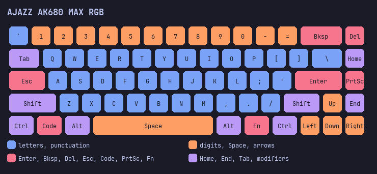

# AJAZZ AK680 MAX — конфигурация как код

Репозиторий с воспроизводимой настройкой клавиатуры **AJAZZ AK680 MAX**
(RY5088, прошивка **v306**, VID:PID `3151:502D`) под Windows.

Одна команда приводит устройство к состоянию из [`config/default.toml`](config/default.toml):
ремапы клавиш, Fn-слой, глубина срабатывания Hall Effect и per-key подсветка.
Вендорский драйвер и права администратора не нужны — используется штатный
HID-интерфейс клавиатуры.



## Что настраивается

| Слой | Что задаётся | Где в конфиге |
|---|---|---|
| Base | позиция матрицы → HID usage | `[layout.base_remaps]` |
| Fn (Win) | Fn + клавиша → HID usage | `[layout.fn_remaps]` |
| Hall Effect | активация / отпускание, мм | `[switches]` |
| Подсветка | палитра зон, яркость, слот userpic, режим LED | `[lighting]` |

Текущий профиль:

- `Caps` → `Esc`, угол (`Esc`) → `` ` `` (в русской раскладке — `ё`);
- правый столбец: `Del`, `Home`, `PrtSc`, `End`;
- `Fn + T` → `` ` `` (запасной способ напечатать `ё`);
- срабатывание 1.0 мм, отпускание 1.5 мм на всех 90 позициях;
- подсветка TokyoNight, раскрашенная **по клавишам**, а не по строкам матрицы.

## Требования

- Windows 10/11 x64 (проверено на Windows; код использует hidapi и потенциально
  переносим, но другие ОС пока не тестировались).
- Python 3.11+.
- Клавиатура подключена проводом.
- Прошивка v306. На другой версии сначала прочитай [`PROVISIONING.md`](PROVISIONING.md).

## Установка

```powershell
git clone https://github.com/jazz-crab/ak680-max.git
cd ak680-max
py -3 -m pip install -e .
```

Если консольная команда `ak680` не появилась в `PATH`, используй
`py -3 -m ak680_max`.

## Быстрый старт

```powershell
ak680 status          # прочитать устройство, ничего не писать
ak680 backup          # снять JSON-бэкап в backups/
ak680 apply           # dry-run: показать план
ak680 apply --yes     # записать конфиг (автобэкап делается сам)
ak680 verify          # сверить устройство с конфигом
ak680 render          # перерисовать preview/*.png без устройства
```

`apply` без `--yes` **ничего не пишет**. Это осознанное правило: сначала
смотрим план, потом заливаем.

## Команды

| Команда | Что делает |
|---|---|
| `status` | читает профиль, keymatrix, Fn, LED, активацию/отпускание |
| `backup [--dir DIR]` | сохраняет полное состояние в JSON (включая userpic) |
| `apply [--yes] [--no-light] [--image FILE]` | приводит устройство к конфигу |
| `verify [--no-light] [--image FILE]` | проверяет совпадение, код возврата 1 при расхождении |
| `restore FILE [--yes]` | best-effort восстановление из JSON-бэкапа |
| `render [--out DIR]` | рисует `userpic-*.png` (данные) и `keyboard-*.png` (превью) |

Общие флаги: `--config PATH` (или переменная `AK680_CONFIG`).

## Конфиг — это намерение, а не байты

`config/default.toml` описывает **что должно получиться**, а не сырые отчёты
протокола. Поэтому при смене устройства или прошивки не нужно переписывать
код: сравниваешь возможности (`base_remaps`, `actuation_mm`, палитру зон) и
переносишь те же правила на новую матрицу.

Ключевые части:

```toml
[switches]
actuation_mm = 1.0
release_mm = 1.5
precision = 100          # v306: 0.01 мм на единицу

[lighting.palette]
orange = "#FF4C00"       # что уходит в прошивку
[lighting.preview_palette]
orange = "#FF9E64"       # как это рисуется на превью
```

Почему палитры две: светодиоды платы имеют разный баланс каналов, поэтому
«задуманный» пастельный цвет при прямой записи вымывается. В прошивку уходят
сочные цвета с компенсацией (`channel_gain`), а PNG-превью рисуется
пастельной палитрой — так на картинке видно замысел, а на железе — результат.

## Структура репозитория

```
ak680-max/
├── config/default.toml       # источник истины
├── src/ak680_max/
│   ├── protocol.py           # feature reports, команды, checksum
│   ├── device.py             # HID-транспорт
│   ├── layout.py             # матрица, физическая раскладка, 90 позиций
│   ├── lighting.py           # палитра -> userpic, PNG-превью
│   ├── config.py             # разбор и валидация TOML
│   ├── state.py              # чтение/бэкап/восстановление/печать
│   └── cli.py                # status/backup/apply/verify/restore/render
├── tools/
│   ├── calibrate_colors.py   # калибровка каналов R/G/B
│   └── diag_colors.py        # диагностика «какой ряд каким цветом»
├── docs/
│   ├── PROTOCOL.md           # формат отчётов и команды
│   └── preview.png
├── assets/fonts/             # JetBrains Mono для превью
├── PROVISIONING.md           # регламент прошивки (Windows)
└── README.md
```

`backups/`, `logs/`, `preview/`, `__pycache__/` — локальные артефакты,
они в `.gitignore`.

## Изменить настройки

1. Правь `config/default.toml`.
2. `ak680 apply` — посмотри план.
3. `ak680 apply --yes`.
4. `ak680 verify`.
5. Проверь клавиши руками: `Caps`, угол, правый столбец, `Fn+T`, глубину.
6. Закоммить конфиг вместе с изменением кода, если оно было.

Перед записью всегда делается автобэкап в `backups/`; `--no-backup` существует
только для отладки.

## Безопасность

- Это **не обновление прошивки MCU**, а запись пользовательского профиля.
  Команда `CMD_SET_RESET` (0x01) в коде объявлена, но **никогда не вызывается**.
- Во время записи не выдёргивай кабель и не запускай вендорскую утилиту.
- Не пиши в устройство, пока не сделал `status` и `backup`.
- Полный регламент, чеклист и таблица восстановления — в
  [`PROVISIONING.md`](PROVISIONING.md).

## Ограничения

- Профиль: активный (или 0..3), но конфигурируется только base-layer и Fn(Win).
- Макросы, tap-hold, несколько слоёв keymatrix и динамические RGB-эффекты не
  настраиваются — только статическая per-key раскраска из конфига.
- `precision = 100` верен для v306. На другой прошивке проверь `status`.
- Windows — единственная протестированная платформа.

## Протокол

Формат feature report, checksum, команды и раскладка userpic описаны в
[`docs/PROTOCOL.md`](docs/PROTOCOL.md). Он основан на публичной документации
monsgeek/akko и проверен на этой плате.
